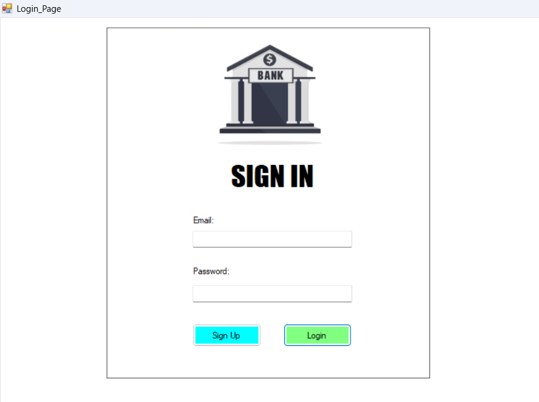
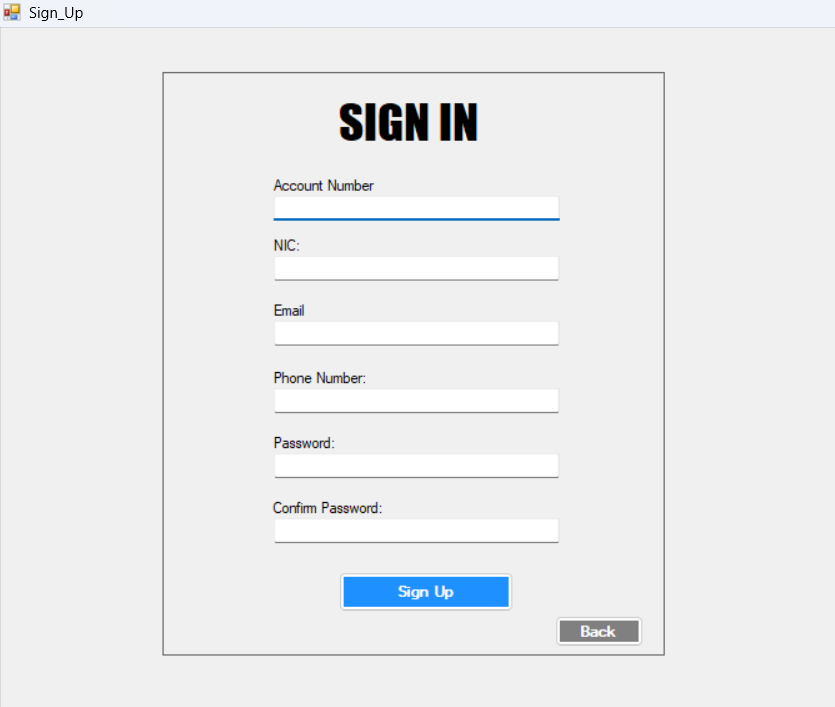
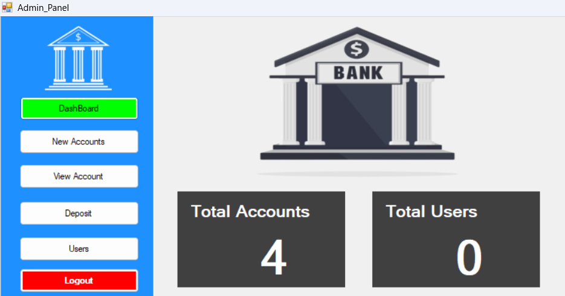
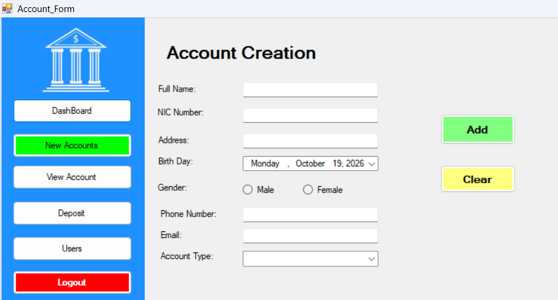
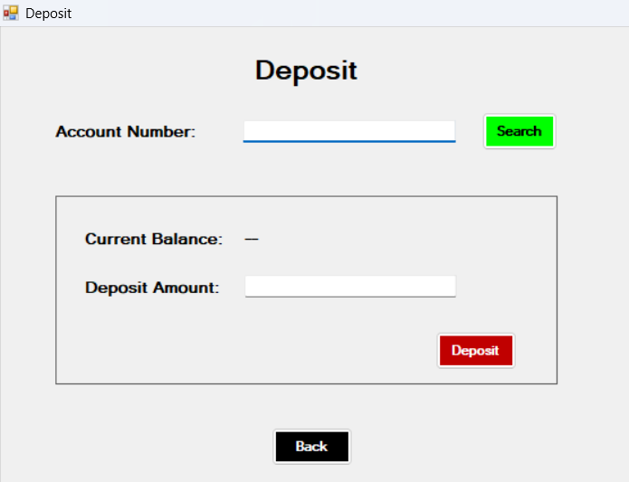
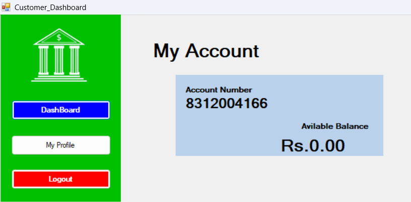

# 🏦 Bank Management System

A desktop-based **Bank Management System** developed using C# Windows Forms and SQL Server. This application helps manage banking operations, customer information, accounts, deposits, and user activities through a graphical user interface.

## 📌 Project Overview

The Bank Management System is designed to simplify basic banking management operations. It provides an interface for administrators and users to manage customer records, create and manage accounts, handle deposits, and access account-related information.

The application uses SQL Server LocalDB to store and manage data persistently.

## ✨ Features

- 🔐 **Login & Registration** – User login and registration interface.
- 👥 **Customer Management** – Add, view, update, and manage customer information.
- 💳 **Account Management** – Create and manage customer bank accounts.
- 🏦 **Account Type Management** – Manage different account types.
- 💰 **Deposit Management** – Handle customer deposit operations.
- 🔎 **User Search & Management** – Search and manage registered users.
- 👤 **User Profiles** – View and manage profile information.
- 📊 **Admin Dashboard** – Access administrative information and statistics.
- 💾 **Database Integration** – Store application data using SQL Server LocalDB.

## 🛠️ Technologies Used

| Technology | Purpose |
|---|---|
| C# | Programming Language |
| Windows Forms | Desktop User Interface |
| .NET Framework 4.8 | Application Framework |
| SQL Server LocalDB | Database Management |
| Visual Studio | Development Environment |

## 📸 Images

Add your application Images inside a folder named `Images` in the project root, then update the filenames below to match your images.

### Sign In Interface


### Sign Up Interface


### Admin Dashboard


### Account Creation


### View Accounts


### Deposit Management


### Customer Profile


## ⚙️ Installation & Setup

Follow these steps to run the project on your computer.

### 1. Clone the Repository

```bash
git clone https://github.com/deshansatheesha/Bank-Management-System.git
```

> Replace the repository URL above if your GitHub repository uses a different name.

### 2. Open the Project

- Open the cloned project folder.
- Locate the Visual Studio solution file (`.sln`).
- Open it using Microsoft Visual Studio.

### 3. Configure the Database

- Make sure SQL Server LocalDB is installed.
- Check the database configuration and connection string in the project.
- Ensure the required database is available and properly configured.

### 4. Build and Run

- Build the solution in Visual Studio.
- Resolve any missing dependency or database configuration issues.
- Press `F5` to run the application.

## 🎯 Project Objectives

- Develop a desktop-based banking management application.
- Understand C# Windows Forms application development.
- Implement database connectivity using SQL Server.
- Practice CRUD operations.
- Improve practical software development skills.

## 🚀 Future Improvements

- Implement withdrawal management.
- Add transaction history.
- Improve security and authentication.
- Generate downloadable account statements.
- Improve the user interface and overall user experience.

## 👨‍💻 Author

**Deshan Satheesha**

- GitHub: [@deshansatheesha](https://github.com/deshansatheesha)
- LinkedIn: [Deshan Satheesha](https://www.linkedin.com/in/deshan-satheesha/)

## 📄 License

This project is intended for educational and learning purposes. Add a `LICENSE` file to the repository if you want to specify the terms under which others may use, modify, or distribute the code.
